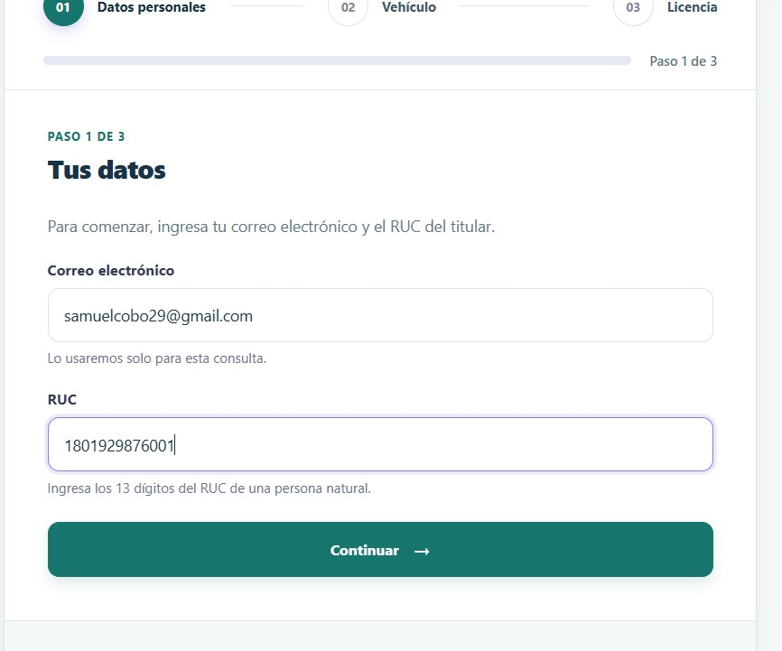
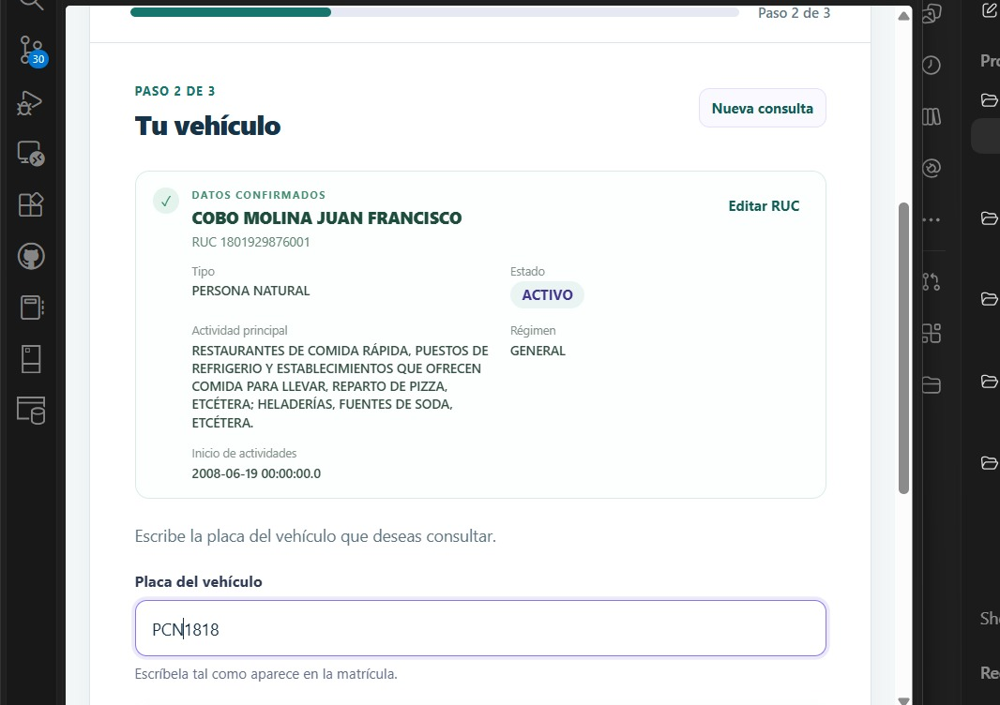
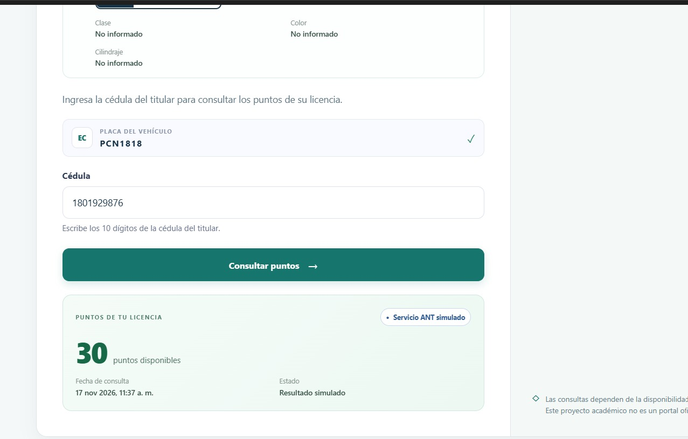
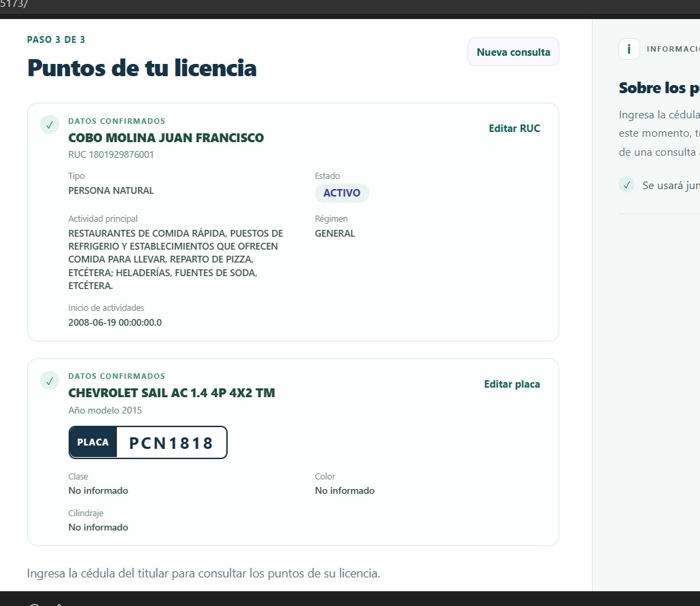

# Sistema Web SRI - ANT

> Aplicación académica para consultar información de contribuyentes, vehículos y puntos de licencia mediante un flujo guiado.

Este proyecto separa una interfaz React de un backend Java Spring Boot. El frontend guía a la persona, valida los datos antes de enviarlos y muestra los resultados de forma clara. El backend concentra las integraciones con SRI, el contrato HTTP versionado, el manejo de errores y la caché de puntos de licencia.

> **Importante:** no es un portal oficial del SRI ni de la ANT. No ingreses ni compartas datos personales reales en capturas, commits o conversaciones.

## 1. Historia de usuario: Paula Cobo

### Historia

> **Como** Paula Cobo, ciudadana que necesita revisar información tributaria y vehicular, **quiero** completar una consulta guiada en pocos pasos, **para** saber qué datos debo ingresar, detectar errores antes de enviarlos y entender si una respuesta proviene de una integración real, una simulación o una consulta guardada.

### Situación inicial

Paula encontraba una pantalla de formulario sin una portada que explicara el objetivo del sistema. El recorrido tenía campos grandes y repetitivos, y algunos errores solo eran evidentes después de presionar el botón de envío. Eso aumentaba la posibilidad de enviar un correo mal escrito, una placa con formato incorrecto o una identificación incompleta.

Las capturas siguientes representan la interfaz anterior:

### Decisiones de la nueva interfaz

La historia de Paula justifica los cambios de esta manera:

| Necesidad de Paula | Cambio realizado | Beneficio |
| --- | --- | --- |
| Entender para qué sirve la página | Se agregó una portada con explicación y botón **Iniciar consulta** | La persona conoce el objetivo antes de entregar información |
| Reconocer el contexto ecuatoriano | Se incorporó una identidad visual con Quito, Ecuador y una ilustración local | La interfaz deja de parecer una plantilla genérica |
| Saber en qué paso está | Se mantuvo el recorrido de tres pasos y se reforzó el indicador de avance | El flujo es predecible y fácil de retomar |
| Corregir antes de enviar | Los campos se validan mientras se escribe y también al salir del campo | Los errores aparecen antes de llamar al backend |
| Escribir una placa correctamente | La interfaz exige letras y números consecutivos, por ejemplo PCN1818 | Evita espacios y guiones como PCN 1818 o PCN-1818 |
| Corregir un correo digitado con error | Se detectan dominios frecuentes mal escritos como gmiol.com | Se muestra una sugerencia de gmail.com antes de enviar |
| Revisar lo que ya fue consultado | Los resultados anteriores se muestran en tarjetas de resumen con opción de editar | Paula no tiene que repetir todo el proceso |
| Saber si los puntos son reales o simulados | La respuesta muestra su origen: SIMULADO, ANT o CACHE | La aplicación no presenta una simulación como información oficial |

### Criterios de aceptación

- Paula puede leer el propósito del sistema antes de iniciar.
- Un campo vacío sin tocar no satura la pantalla con errores.
- Un valor inválido no vacío muestra su error antes de presionar **Continuar**.
- Un correo debe pertenecer a un proveedor permitido, como gmail.com, yahoo.es, hotmail.com, outlook.com, icloud.com o proton.me.
- Una placa válida tiene de 5 a 8 letras y números, sin espacios ni guiones.
- Un RUC contiene 13 dígitos y una cédula contiene 10 dígitos.
- El backend recibe solicitudes bajo /api/v1/ y devuelve errores JSON consistentes.
- La consulta de puntos de licencia indica que usa ANT simulada mientras el sitio externo permanezca indisponible.
+

## 2. Cómo funciona el sistema

~~~text
Navegador
   │
   │ React + Vite
   │ /api → proxy local
   ▼
Spring Boot :8080
   ├── GET  /api/v1/health
   ├── POST /api/v1/consultas/contribuyentes ── SRI real
   ├── POST /api/v1/consultas/vehiculos       ── SRI real
   └── POST /api/v1/consultas/licencias       ── ANT simulada por defecto
                                                   │
                                                   └── Redis Cloud para caché
~~~

### Flujo de la persona

1. Paula abre la portada y selecciona **Iniciar consulta**.
2. Ingresa correo y RUC.
3. El frontend valida los campos antes de enviar.
4. El backend consulta el SRI y devuelve un resumen de la persona natural.
5. Paula ingresa la placa sin espacios ni guiones.
6. El backend consulta el vehículo en el SRI y devuelve sus datos resumidos.
7. Paula ingresa la cédula de 10 dígitos.
8. El sistema consulta los puntos usando el contrato de ANT.
9. Si el proveedor simulado está habilitado, se muestra el resultado con origen SIMULADO.
10. Si existe un resultado válido anterior y el proveedor falla, Redis puede devolverlo como CACHE y la interfaz advierte que puede estar desactualizado.

### Qué valida el frontend antes de enviar

La función errorVisibleCampo centraliza la validación en vivo para todos los campos:

- **Correo:** formato, longitud máxima, dominio permitido y errores frecuentes de digitación.
- **RUC:** exactamente 13 dígitos.
- **Placa:** de 5 a 8 letras y números consecutivos; no acepta espacios ni guiones.
- **Cédula:** exactamente 10 dígitos.

La regla de experiencia es deliberada: un campo vacío y todavía no visitado permanece limpio; cuando Paula empieza a escribir un valor inválido, el error aparece inmediatamente. Al salir del campo o presionar el botón, también se muestran los errores de campos vacíos.

El botón de envío vuelve a validar todos los campos. Aunque una persona intente saltarse la interfaz, el backend mantiene su propia validación de solicitud con Jakarta Bean Validation.

## 3. Estructura del repositorio

~~~text
backend/
├── pom.xml
└── src/
    ├── main/java/ec/edu/udla/arquitecturac4/
    │   ├── api/                 Manejo común de errores HTTP
    │   ├── consulta/            Casos de uso y controlador REST
    │   ├── consulta/sri/        Clientes y DTOs del SRI
    │   ├── consulta/ant/        Cliente ANT real y proveedor simulado
    │   ├── consulta/cache/      Redis, HMAC y recuperación de datos
    │   └── health/              Endpoint técnico de salud
    └── test/                    Pruebas unitarias, MockMvc e integración

frontend/
├── package.json
├── vite.config.js
└── src/
    ├── App.jsx                  Flujo de pantallas y componentes visuales
    ├── styles.css               Identidad visual y diseño responsive
    ├── api/consultas.js         Cliente HTTP del frontend
    └── consulta/                Estado, validaciones, errores y progreso

docs/
├── api/openapi.yaml             Contrato HTTP versionado
├── CONFIGURACION_LOCAL.md       Redis, perfiles y ANT simulada
└── evidencia/                   Capturas de pruebas y evolución visual
~~~

## 4. Instalación y ejecución local

### Requisitos

- Java 21.
- Maven.
- Node.js 20.19 o superior.
- npm.
- Redis Cloud solo si se quiere probar la recuperación desde caché.

### Backend

Desde la raíz del proyecto:

~~~powershell
Set-Location .\backend
mvn spring-boot:run
~~~

El backend inicia normalmente en http://localhost:8080. El perfil predeterminado es live.

### Frontend

En otra terminal:

~~~powershell
Set-Location .\frontend
npm install
npm run dev
~~~

Vite muestra la URL disponible, normalmente http://localhost:5173. Si ese puerto está ocupado puede elegir 5174. El proxy de frontend/vite.config.js redirige /api hacia http://localhost:8080.

### Verificación rápida del backend

~~~powershell
Invoke-RestMethod -Uri "http://localhost:8080/api/v1/health"
~~~

Respuesta esperada:

~~~json
{
  "status": "UP",
  "application": "sri-ant-backend"
}
~~~

## 5. API versionada: qué significa y cómo comprobarla

### ¿La versionada está funcionando?

Sí. La API usa versionado por URL. El prefijo actual es /api/v1 y está definido en:

- ConsultaController.java: @RequestMapping("/api/v1/consultas").
- HealthController.java: @RequestMapping("/api/v1/health").
- frontend/src/api/consultas.js: las tres llamadas consumen rutas /api/v1/....
- docs/api/openapi.yaml: documenta las rutas de v1.

La versión v1 no es lo mismo que el campo info.version: 1.0.0 de OpenAPI. La primera identifica la versión pública de las rutas; la segunda identifica la versión del documento del contrato.

Actualmente no existe una v2. Eso es correcto: mientras el contrato no cambie de manera incompatible, los clientes siguen usando v1.

### Rutas actuales

| Método | Ruta | Propósito |
| --- | --- | --- |
| GET | /api/v1/health | Confirmar que el backend está levantado |
| POST | /api/v1/consultas/contribuyentes | Consultar RUC y mostrar una persona natural |
| POST | /api/v1/consultas/vehiculos | Consultar un vehículo por placa |
| POST | /api/v1/consultas/licencias | Consultar puntos con cédula y placa |

### Cómo probar que v1 funciona

1. Levanta el backend.
2. Ejecuta el endpoint de salud:

   ~~~powershell
   Invoke-RestMethod -Uri "http://localhost:8080/api/v1/health"
   ~~~

3. Comprueba que el frontend llama rutas v1 revisando DevTools → **Network** → una solicitud /api/v1/consultas/....
4. Ejecuta las pruebas del backend:

   ~~~powershell
   Set-Location .\backend
   mvn -B -ntp test
   ~~~

5. Revisa el contrato:

   ~~~powershell
   Get-Content .\docs\api\openapi.yaml -TotalCount 20
   ~~~

### Cómo se crearía una v2

Una v2 solo sería necesaria si se rompe la compatibilidad, por ejemplo, si cambia el nombre de un campo obligatorio o la forma de una respuesta. La estrategia sería:

1. Crear rutas /api/v2/... y DTOs de v2.
2. Mantener /api/v1/... durante el período de transición.
3. Actualizar el contrato OpenAPI y agregar pruebas específicas de ambas versiones.
4. Migrar el frontend de forma controlada.
5. Retirar v1 solo después de avisar y comprobar que ningún cliente la utiliza.

No se debe cambiar /api/v1 directamente si el cambio rompe a quien ya consume la API.

## 6. Pruebas automatizadas

### Suite completa del backend

~~~powershell
Set-Location .\backend
mvn -B -ntp test
~~~

Incluye pruebas de:

- HealthControllerTest: salud de la aplicación.
- ConsultaControllerTest: rutas, respuestas exitosas y errores HTTP.
- ConsultaServiceTest: reglas de negocio y resumen de respuestas.
- Clientes SRI: respuestas válidas, vacías, inválidas, redirecciones y timeouts.
- AntHtmlParserTest y ANTClientTest: interpretación segura del contrato ANT.
- SimulatedAntClientTest: puntos simulados y proveedor no disponible.
- LicenciaCacheServiceTest y RedisLicenciaCacheTest: frescura, fallback y expiración.
- ApiExceptionHandlerTest: formato seguro de los errores.

El smoke test RedisCloudConnectivityIT se ejecuta solo cuando existen localmente REDIS_URL y ANT_CACHE_KEY_SECRET con al menos 32 bytes. Si no existen, se omite mediante una asunción y no se debe pegar ninguna credencial en el repositorio.

### Pruebas específicas del backend

~~~powershell
mvn -B -ntp '-Dtest=HealthControllerTest' test
mvn -B -ntp '-Dtest=ConsultaControllerTest' test
mvn -B -ntp '-Dtest=ConsultaServiceTest' test
mvn -B -ntp '-Dtest=SimulatedAntClientTest,LicenciaCacheServiceTest' test
~~~

### Suite completa del frontend

~~~powershell
Set-Location ..\frontend
npm install
npm test
npm run build
~~~

La suite cubre:

- Estado y transición entre los tres pasos.
- Cliente HTTP y contrato de las tres consultas.
- Mensajes de error seguros.
- Progreso y navegación hacia pasos ya completados.
- Portada inicial y composición visual de Quito.
- Validación de correo, RUC, placa y cédula.
- Validación en vivo antes de presionar **Continuar**.
- Sugerencias de dominios como gmiol.com → gmail.com.

Para enfocarse en validaciones:

~~~powershell
npm test -- --test-name-pattern "correo|dominio|placa|vivo|campo"
~~~

## 7. Cómo probar los errores de la interfaz

Abre la página, presiona **Iniciar consulta** y prueba cada caso sin enviar todavía:

| Campo | Valor de prueba | Resultado esperado |
| --- | --- | --- |
| Correo | persona@dominio-no-permitido.test | Error de proveedor no permitido |
| Correo | persona@gmiol.com | Sugerencia para usar gmail.com |
| Correo | persona@gmail.com | Sin error |
| RUC | 123 | Error: debe tener 13 dígitos |
| RUC | 1801929876001 | Formato válido; luego depende del SRI |
| Placa | PCN 1818 | Error: contiene espacio |
| Placa | PCN-1818 | Error: contiene guion |
| Placa | PCN1818 | Sin error de formato |
| Cédula | 123 | Error: debe tener 10 dígitos |
| Cédula | 1801929876 | Formato válido; luego usa el proveedor ANT configurado |

La validación local no confirma que un RUC, placa o cédula pertenezca realmente a una persona. Solo comprueba la forma de entrada. La confirmación de datos ocurre en el backend y en los servicios configurados.

### Qué verificar visualmente

- El error aparece mientras existe un valor inválido, antes de **Continuar**.
- El borde o estado del campo cambia a error.
- El mensaje se anuncia con role="alert".
- aria-invalid="true" se establece en el input con error.
- Al corregir el valor, el error desaparece.
- Al enviar un formulario incompleto, el foco vuelve al primer campo inválido.
- No se imprimen RUC, cédula, correo ni placa dentro de mensajes genéricos del backend.

## 8. Pruebas manuales de la API

### Validación 400

Con el backend iniciado:

~~~powershell
$body = '{"correo":"correo-invalido","ruc":"123"}'
try {
  Invoke-WebRequest -Uri "http://localhost:8080/api/v1/consultas/contribuyentes" -Method Post -ContentType "application/json" -Body $body
} catch {
  $_.Exception.Response.StatusCode.value__
  $_.ErrorDetails.Message
}
~~~

Debe responder 400 con código VALIDATION_ERROR y errores por campo.

### JSON inválido

~~~powershell
try {
  Invoke-WebRequest -Uri "http://localhost:8080/api/v1/consultas/vehiculos" -Method Post -ContentType "application/json" -Body '{placa:'
} catch {
  $_.Exception.Response.StatusCode.value__
  $_.ErrorDetails.Message
}
~~~

Debe responder 400 INVALID_JSON.

### Método o tipo de contenido incorrecto

~~~powershell
try {
  Invoke-WebRequest -Uri "http://localhost:8080/api/v1/consultas/contribuyentes" -Method Get
} catch {
  $_.Exception.Response.StatusCode.value__
}

try {
  Invoke-WebRequest -Uri "http://localhost:8080/api/v1/consultas/vehiculos" -Method Post -ContentType "text/plain" -Body "PCN1818"
} catch {
  $_.Exception.Response.StatusCode.value__
}
~~~

Los resultados esperados son 405 METHOD_NOT_ALLOWED y 415 UNSUPPORTED_MEDIA_TYPE.

## 9. SRI real y ANT simulada

### SRI

El backend usa clientes HTTP reales para:

- Verificar la existencia del RUC.
- Obtener el detalle del contribuyente.
- Buscar el vehículo por placa.

Las rutas, tiempos de espera y URL base se configuran en backend/src/main/resources/application.yml mediante variables como SRI_BASE_URL, SRI_EXISTS_PATH, SRI_DETAILS_PATH, SRI_VEHICLE_PATH, SRI_CONNECT_TIMEOUT y SRI_READ_TIMEOUT.

La aplicación no copia la respuesta externa completa hacia el navegador. Selecciona los campos necesarios y transforma los errores externos en respuestas seguras como 404, 422, 502 o 503.

### Por qué la consulta de cédula/puntos es simulada

La cédula se valida localmente como un identificador de 10 dígitos. Sin embargo, el último paso no verifica por sí solo la identidad: consulta puntos de licencia enviando cédula y placa al contrato de ANT.

Durante la implementación, el sitio externo de ANT comprobado respondió 502 Bad Gateway. Por esa razón no era correcto presentar una respuesta como si fuera real. Se tomó la decisión de:

1. Mantener el mismo contrato de entrada: cédula y placa.
2. Mantener el mismo contrato de salida: puntos, fecha, origen y estado de frescura.
3. Usar SimulatedAntClient en el perfil live por defecto.
4. Mostrar en la interfaz el origen Servicio ANT simulado.
5. Conservar la implementación HTTP real detrás del perfil ant-real, para activarla cuando el sitio externo vuelva a estar disponible.

La simulación devuelve 30 puntos por defecto y puede configurarse con ANT_SIMULATION_POINTS. Si ANT_SIMULATION_AVAILABLE=false, se puede probar el error de disponibilidad y la recuperación desde Redis.

Esto no significa que la cédula sea falsa ni que el formato no se valide. Significa que la fuente externa que debería devolver los puntos no estaba disponible, por lo que el sistema usa una respuesta controlada y transparente para demostrar el flujo sin ocultar la limitación.

### Origen de una respuesta de licencia

| Origen | Significado |
| --- | --- |
| SIMULADO | Respuesta del proveedor ANT simulado |
| ANT | Respuesta del cliente ANT real, disponible mediante el perfil ant-real |
| CACHE | Última respuesta válida guardada en Redis |

## 10. Probar la simulación y la caché

Para la prueba básica de licencia no se necesita una conexión real a Redis. Para probar la recuperación de datos anteriores sí se necesita Redis Cloud y un secreto HMAC local.

La guía detallada de configuración está en [docs/CONFIGURACION_LOCAL.md](docs/CONFIGURACION_LOCAL.md). El flujo resumido es:

1. Configurar REDIS_URL y ANT_CACHE_KEY_SECRET solo en la terminal local.
2. Mantener ANT_SIMULATION_AVAILABLE=true.
3. Ejecutar una consulta de licencia y confirmar Servicio ANT simulado.
4. Dejar que expire la frescura configurada.
5. Reiniciar con ANT_SIMULATION_AVAILABLE=false.
6. Repetir la consulta y comprobar que aparece el último resultado con origen CACHE y advertencia de posible desactualización.
7. Restaurar ANT_SIMULATION_AVAILABLE=true y la frescura normal.

La clave de Redis se construye con HMAC; no se guarda el correo ni el RUC dentro del valor de caché.

## 11. Contrato de errores

| HTTP | Código | Cuándo aparece |
| --- | --- | --- |
| 400 | VALIDATION_ERROR | Campos con formato inválido |
| 400 | INVALID_JSON | JSON mal formado o propiedades desconocidas |
| 404 | CONTRIBUYENTE_NO_ENCONTRADO, VEHICULO_NO_ENCONTRADO, LICENCIA_NO_ENCONTRADA | No existe el registro solicitado |
| 422 | NO_ES_PERSONA_NATURAL | El RUC no corresponde a una persona natural |
| 502 | SRI_RESPUESTA_INVALIDA, ANT_RESPUESTA_INVALIDA | El upstream responde con datos no interpretables |
| 503 | SRI_NO_DISPONIBLE, ANT_NO_DISPONIBLE, CACHE_NO_CONFIGURADA | Servicio temporalmente no disponible o caché sin configuración |
| 405 | METHOD_NOT_ALLOWED | Método HTTP no permitido |
| 415 | UNSUPPORTED_MEDIA_TYPE | El cuerpo no es JSON compatible |
| 500 | INTERNAL_ERROR | Error interno no previsto, sin filtrar detalles |

La especificación completa se encuentra en [docs/api/openapi.yaml](docs/api/openapi.yaml).

## 12. Evidencia visual y técnica

Las capturas del cambio visual están guardadas en docs/evidencia/:

- README_ANTES_01_datos-personales.png a README_ANTES_04_paso-licencia.png: estado anterior usado para justificar la mejora UX.
- EVIDENCIA_ETAPA7_01_Interfaz_Ciudadana.jpg: evidencia de la evolución de la interfaz.
- EVIDENCIA_ETAPA7_04_Pruebas_Frontend.png: ejecución de pruebas del frontend.
- EVIDENCIA_ETAPA7_05_Build_Frontend.png: build de producción del frontend.

Antes de subir nuevas capturas:

- Oculta correos, RUC, cédulas, placas, contraseñas y URI de Redis.
- No uses datos personales reales si no tienes autorización.
- No subas .env, secretos HMAC ni credenciales de Redis Cloud.

## 13. Definición de terminado

Se considera que una entrega está lista cuando:

~~~powershell
Set-Location .\backend
mvn -B -ntp test

Set-Location ..\frontend
npm test
npm run build
~~~

terminan sin fallos, el endpoint /api/v1/health devuelve status: UP, la interfaz muestra errores antes de enviar, el resultado de licencia identifica si es simulado o cacheado y el árbol de Git no contiene secretos ni datos personales.

## 14. Documentación complementaria

- [Configuración local, Redis y ANT simulada](docs/CONFIGURACION_LOCAL.md)
- [Contrato OpenAPI versionado](docs/api/openapi.yaml)
- [Evidencias del proyecto](docs/evidencia/)
- [Diseño de la interfaz ciudadana](docs/superpowers/specs/2026-11-17-consulta-ciudadana-ux-design.md)
- [Diseño visual Ecuador/Quito](docs/superpowers/specs/2026-11-17-frontend-ecuador-visual-design.md)

+

