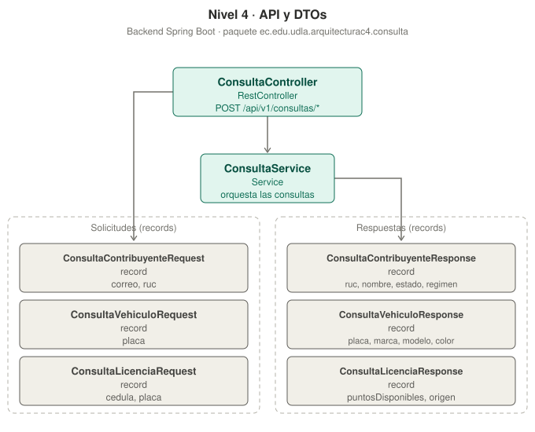
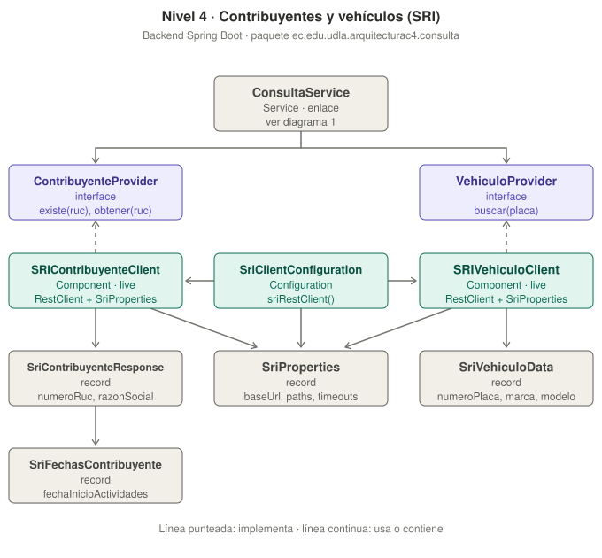
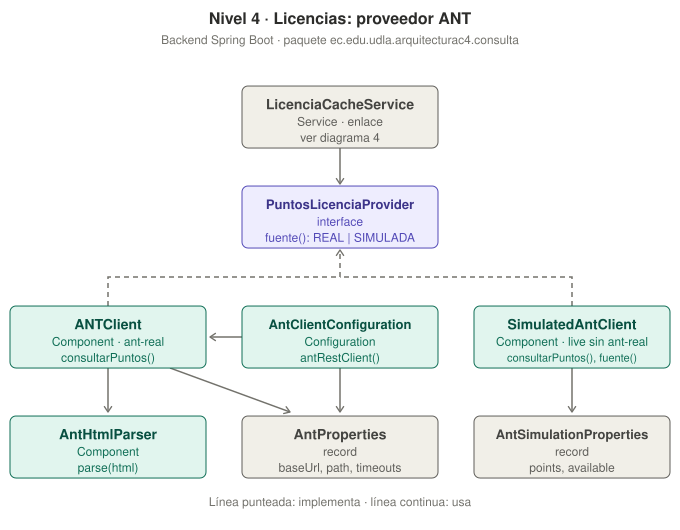
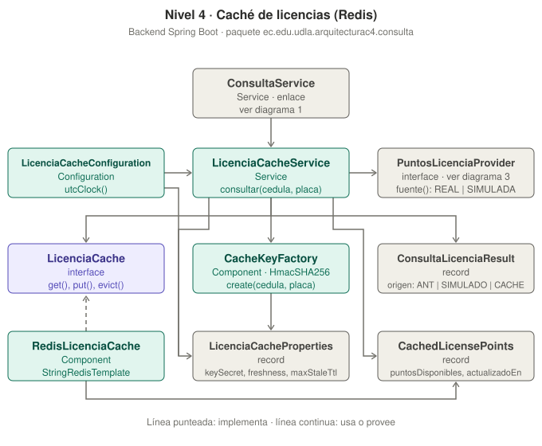

# Arquitectura C4 · Nivel 4: Código

> Diagramas de clases del backend Spring Boot (Java), paquete `ec.edu.udla.arquitecturac4.consulta`.
> Según el modelo C4, el nivel 4 detalla el código de un componente. Por eso se divide en cuatro diagramas pequeños en lugar de uno solo con todas las clases.

**Cómo leerlos**

| Elemento | Significado |
| --- | --- |
| Caja morada | Interfaz |
| Caja verde azulada | Servicio, componente o configuración de Spring |
| Caja gris | Record, o clase de enlace con otro diagrama |
| Línea continua | Usa, contiene o provee |
| Línea punteada | Implementa |

Las clases marcadas **«enlace»** se repiten en el diagrama siguiente para mostrar cómo se conectan entre sí.

**Fuera de alcance:** las 10 excepciones del dominio (no tienen comportamiento), `ApiExceptionHandler`, `HealthController` y el frontend React.

---

## 1. API y DTOs

`ConsultaController` recibe las solicitudes y delega en `ConsultaService`, que devuelve las respuestas.

## 2. Contribuyentes y vehículos (SRI)

`ConsultaService` depende de dos interfaces; cada una la implementa un cliente del SRI (perfil `live`). `SriClientConfiguration` provee el `RestClient` de ambos.

## 3. Licencias: proveedor ANT

`PuntosLicenciaProvider` tiene dos implementaciones: `ANTClient` (perfil `ant-real`) y `SimulatedAntClient` (perfil `live` sin `ant-real`).

## 4. Caché de licencias (Redis)

`LicenciaCacheService` consulta primero la caché (`LicenciaCache`, implementada por `RedisLicenciaCache`) y solo llama al proveedor ANT cuando el dato no está vigente. La clave se genera con HMAC-SHA256 en `CacheKeyFactory`.

